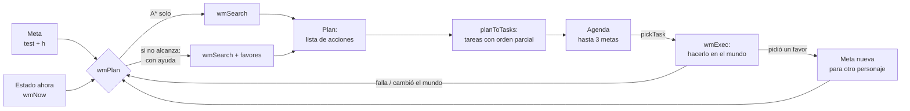

# Cómo planifican los personajes de Avonlea

Los personajes no siguen guiones. Cada uno recibe **metas** («que la Sra. Barry tenga compota», «que Dolly quede en el corral») y busca con **A\*** la secuencia de acciones más barata que las cumple. Después la ejecuta en el mundo del juego y, si algo cambia, vuelve a planificar. Es IA clásica, sin IA generativa: todo es datos y búsqueda.

Este documento explica los componentes: el **estado**, las **acciones**, las **metas**, la **búsqueda A\***, cómo un plan se convierte en tareas y cómo se ejecutan. La lista completa de cosas, lugares, personas, acciones y metas está en el **[catálogo](CATALOGO.md)**, generado desde los datos del juego. Cómo se cumplió cada meta de prueba, dibujado en el mapa, está en **[trazas/metas.pdf](../trazas/metas.pdf)**.

Todo el código está en `index.html`, en la sección *THE WORLD MODEL*. Aquí se nombran las funciones; búscalas por su nombre.



---

## 1. El estado

El planificador no ve píxeles. Ve una **foto abstracta del mundo** que arma `wmNow()`:

```js
{
  t: 600,                                   // la hora, en minutos (10:00)
  pos:   { ana: 'cocina', diana: 'h:os', barry: 'h:os', … },   // dónde está cada uno, como LUGAR
  invs:  { ana: { manzanas: 0, cuerda: 0, … }, diana: { compota: 0 }, … },
  cows:  { dolly: 'corral', jersey: 'potrero' },
  rel:   { 'diana>barry': 2, 'ana>diana': 3, … },   // cariño, de -2 a 5
  ofensa:{ 'ana>gilbert': 'zanahorias' },
  know:  { lynde: [], ana: ['vendio_vaca'] },       // noticias que cada uno sabe
  follow:{},                                         // quién acompaña a quién
  facts: { 'pedido:traer:diana': 1 },                // hechos del día (para no repetir)
  stock: { bayas: 9, manzanas: 36, huevos: 6, … }    // lo que queda para recoger
}
```

Algunas ideas clave:

- **Los lugares son discretos.** Una posición no es `(x, y)` sino un nombre:
  - un punto del mapa (`granero`, `huerto`, `tienda`…);
  - `cocina` (dentro de Tejas Verdes);
  - `h:casa` (dentro de otra casa);
  - `p:quien` (afuera, donde esa persona esté).

  Así hay pocos estados posibles, y «estar con alguien» es simplemente estar en el mismo lugar. `personKey(k)` traduce la posición real de cada uno a su lugar.
- **El mismo estado sirve para planificar y para revisar el mundo.** Una meta se comprueba con su `test(estado)` tanto sobre un estado imaginado por A\* como sobre `wmNow()`.
- **Estados repetidos.** `sKey(s)` resume un estado en un texto para reconocer los ya visitados. `clone(s)` lo copia para probar una acción sin tocar el original.

## 2. Las acciones (verbos)

Una acción es un objeto con el verbo, su costo en **minutos** y una función `eff` que modifica una copia del estado:

```js
{ v: 'recoger', x: 'manzanas', n: 3, cost: 3, eff: t => { t.invs[me].manzanas += 3; t.stock.manzanas -= 3; } }
```

`verbs(s, me, C)` devuelve **todas las acciones que `me` puede hacer en el estado `s`**: ir a cada lugar relevante, tomar o recoger lo que el lugar ofrece, cocinar si está en su cocina y tiene los ingredientes, y dar, vender, cambiar, conversar, disculparse o pedir a quien esté en el mismo lugar…

Las acciones son las mismas para todos, Ana incluida. Las diferencias salen de los datos:

- Marilla es `quieto`, así que no tiene acción `ir`.
- Solo el Sr. Shearer compra vacas.
- Solo el Sr. Lawson hace trueque, y solo de 8 a 18.

Los costos son tiempo:

- **Caminar** cuesta lo que toma (`travelMin`: distancia × 1,3 ÷ velocidad, más 2 minutos si se entra o sale de una casa).
- **Recoger** cuesta 3 minutos.
- **Cocinar** cuesta 10 minutos.
- **Pedir un favor** cuesta la espera de que el otro lo haga, más un recargo de 40 minutos para quien puede hacerlo él mismo. Así se prefiere hacerlo uno mismo y se pide solo cuando conviene.

**Poda:** antes de buscar, `wmSearch` arma un contexto `C` con solo lo que importa para la meta:
- las cosas de la meta y sus ingredientes;
- las personas de la meta, las que compran o venden, y aquellas a quienes se puede pedir;
- los lugares donde están esas personas y esas cosas, la cocina, el corral y el potrero.

Así `verbs` genera decenas de acciones por estado y no cientos.

Las **reglas sociales** (`socialRule`) son las mismas para el plan y para el mundo:
- un regalo que le gusta sube el cariño;
- disculparse puede borrar una ofensa;
- pedir funciona si el otro te quiere al menos 2 o es generoso.

## 3. Las metas

Una meta es una **condición** y una **estimación de lo que falta**:

```js
G.tener('barry', 'compota', 1) = {
  text:  'Sra. Barry tiene 1 compota de manzana',
  test:  s => (s.invs.barry.compota || 0) >= 1,          // ¿se cumple?
  h:     s => …,     // pasos que faltan, aproximados: 0 si ya; 1 si alguien ya la tiene; 3 si hay que cocinarla…
  items: ['compota', 'manzanas'],  people: ['barry'],     // lo que importa (para la poda)
}
```

Hay metas de cosas (`tener`, `dinero`, `regalar_cosa`), de vacas (`vaca_en`, `vaca_vendida`), sociales (`reconciliar`, `rel_min`, `regalo_gusto`, `intercede`), de noticias (`conoce`), de compañía (`acompana`, `te_con`) y de lugar con hora límite (`estar_en`). La tabla está en el [catálogo, §3](CATALOGO.md#3-las-metas).

## 4. La búsqueda: A\*

`wmSearch(me, meta, favores, s0, tope)` es un **A\*** sobre estados, igual que el que busca caminos en el mapa, pero los «nodos» son estados del mundo y las «aristas» son acciones:

```
abierta ← { s0 }   (cola de prioridad por f)          visitados[sKey(s0)] = 0
mientras abierta no esté vacía y no se pase del tope:
    cur ← el de menor f
    si meta.test(cur.s): devolver cur.camino            ← plan encontrado
    si cur.camino tiene 12 pasos: no seguir por aquí
    para cada acción a en verbs(cur.s, me, C):
        t ← copia de cur.s;  a.eff(t);  t.t += a.costo
        si la meta tiene hora límite y t.t la pasa: descartar
        g ← cur.g + a.costo                              (minutos gastados)
        si ya se llegó a t por menos: descartar
        f ← g + 40 · meta.h(t)                           (minutos + 40 por paso que falta)
        meter t en la abierta
```

- **g** son los minutos gastados hasta ese estado.
- **h** son los pasos que faltan según la meta, y cada paso vale **40 minutos**. Este peso alto hace que la búsqueda vaya derecho a lo que acerca a la meta. Es un A\* **ponderado**: encuentra planes buenos muy rápido, aunque no siempre el óptimo.
- La cola de prioridad es un *heap* binario, y los visitados se guardan por `sKey` con su mejor `g`.
- **Límites:** 12 acciones por plan, y como máximo 1.500 estados expandidos (2.500 con ayuda de otros, 6.000 si se está cumpliendo un favor y faltó espacio).
- **Si no hay solución**, devuelve el mejor **plan parcial** (el que dejó la meta más cerca). El personaje avanza lo que puede, y si al final no alcanza dice «avanzó, pero no lo suficiente por hoy». Si no hay ni eso: «no hay un plan posible».

### Primero solo, después con ayuda

`wmPlan` busca primero un plan **propio**, usando solo los favores que la meta sugiere. Si no lo encuentra, agrega como posibles favores a quienes podría pedirles (`autoFavors`):

- a los de su casa, o a un amigo (cariño ≥ 3);
- si quien planifica no sale de casa, solo a quien esté con él, o puede mandar a llamar a Ana.

Luego busca de nuevo. Las cadenas tienen un máximo de tres personas (A le pide a B, que le pide a C), y nadie le pide a alguien que ya está en la cadena (`exclude`).

## 5. Del plan a las tareas (orden parcial)

Un plan es una lista, pero no todo depende de todo. `planToTasks` convierte el plan en **tareas con dependencias**:

- **Caminar no es una tarea:** se camina hasta donde se hace la tarea elegida. Se mantiene solo el último `ir`, o uno donde alguien acompaña, porque ahí llegar es el objetivo.
- **La tarea *j* depende de la *i*** si, al rehacer el plan **sin** la *i*, la *j* no se puede hacer o no produce el mismo cambio. La comparación se hace sobre el cambio exacto de cada paso (`delta`).

Ejemplo (registro real de Ana):

```
plan: 1. recoger 3 manzanas · 2. cocinar compota [tras 1] · 3. darle 1 compota a Diana [tras 1, 2]
```

## 6. La agenda: varias metas a la vez

Cada personaje (`agentOf`) tiene hasta **3 metas activas** (`MAX_GOALS`), y sus tareas se mezclan:

- **Prioridad:** 3 si la meta tiene hora límite (va primero), 2 si se la pidió alguien, 1 si es propia.
- **`pickTask`** elige la siguiente tarea lista mirando **tres tareas hacia adelante**, en un orden que respete las dependencias. Se queda con la secuencia que **menos camina**, con dos ajustes:
  - postergar lo que pidió otro cuesta un poco;
  - caminar llevando una vaca de la cuerda cuesta más.

  Por ejemplo, Ana con tres metas recoge huevos, lleva manzanas a Diana, cambia los huevos por la cinta en la tienda, saca azúcar a la libreta y se la lleva a Marilla, todo en una vuelta.

## 7. La ejecución en el mundo

`agentTick` lleva a cada personaje por su tarea actual, y `wmExec` la hace con las funciones del juego:

- **Caminar:** `wmMove` lleva al personaje por los caminos y entra o sale de las casas. Para hablar con alguien se acerca hasta tenerlo al lado (~40 px; o en la misma habitación).
- **Pedir:** muestra el globo con el pedido. Si el otro acepta, se le instala la meta con `agentStart`, y quien pidió sigue con lo demás. Lo prometido cuenta como hecho al replanificar (`promised`). Se espera solo donde hace falta («⏳ espera lo que pidió»).
- **Quien no sale de casa** (o está enfermo) **manda a llamar** a Ana: ella va, y ahí se le pide.
- **Llamar a alguien:** si la persona a quien se va a ver se está alejando, quien la busca la llama («¡Matthew! ¡Espera!») cuando está a distancia de voz (`CALL_R`, 520 px). La persona se detiene y mira, o viene si quiere a quien la llama (cariño ≥ 3, familia o niños). Espera unos 14 s (`callPerson`, `calledHold`). La jugadora también puede llamar: botón 📣 o tecla L (a quien esté más cerca), y al tocar a alguien que se va, Ana le grita que espere.
- **Un paseo** (`paseo`): quien pide va donde la otra, le pide pasear (la otra la sigue), caminan juntas hasta el lugar (el lago) y se quedan un rato conversando. Recién entonces el paseo termina y cada una sigue con lo suyo.
- **Invitar para más tarde** (favor `venir`): la Sra. Allan invita a Ana cuando se encuentran (en la iglesia) a tomar el té a las 17 (o algo más tarde si ya es tarde). Ana recibe una meta **para más tarde** (`desde`: no se planifica hasta su hora), sigue con lo suyo y a la hora va a la casa parroquial. Mientras, la Sra. Allan prepara el té y la espera.
- **Acciones del libro** (ver [ACCIONES_DEL_LIBRO.md](ACCIONES_DEL_LIBRO.md)): quehaceres, ordeñar, dar de comer a los animales, visitar, prestar y devolver, jurar ser amigas del alma, perdonar, cuidar a un enfermo o avisar al médico, estudiar y recitar, rezar, coser, adornar el sombrero, remar, ponerle nombre a un lugar, regañar y llevar en la calesa.
  - **Cada una se ofrece solo si sirve para la meta** (`C.kind`, o las cosas de la meta). Si no, el planificador perdería el tiempo probando combinaciones de acciones que no importan: en la cocina, Ana puede rezar, estudiar, lavar los platos…
  - **Algunos hechos son para siempre** (`game.wm.perm`): las amigas del alma, y los nombres que Ana les pone a los lugares, que aparecen en el mapa.
- **Cómo se ve cada acción** (`ACCION_VISTA`, pura configuración): mientras se hace una acción del libro, se ve con qué se hace y cómo:
  - **objetos:** el mantel a cuadros, la canasta, los sándwiches y el helado del picnic; el trineo; los patines; el bote y los remos; el frasco y la palangana del tinte; las tijeras y los mechones verdes que caen; el libro, el papel y la pluma; el hacha y el tronco; la horquilla y los fardos; las semillas; la regadera; el balde de grano; la escoba, la palangana de platos; el bol y la cuchara; la mantequera; la costura; el canastito; el jarabe y la cuchara; la corona de flores en el sombrero;
  - **postura:** sentada en el picnic (y Diana al lado), en el bote, cosiendo o rezando; de cara al espejo para teñirse;
  - **movimiento:** colina abajo en el trineo y de vuelta arriba tirándolo; patinando en ronda sobre el hielo; remando en el lago; caminando por el techo de los Barry;
  - **duración:** cada una dura lo suficiente para verse (`dur`);
  - **lo que queda:** el pelo verde después del tinte; corto, sin trenzas, después de que Marilla lo corta; la corona de flores en el sombrero el resto del día.

  `wmExec` marca quién está haciendo qué (`ag.acting`) y el dibujo lo lee (`accPush`). Para que una acción nueva se vea, basta una línea en `ACCION_VISTA` y, si usa un objeto nuevo, su dibujo en `ACC_OBJ`.
- **El jugador puede hacer lo mismo** (`jugables`, `jugar`): al tocar a Ana, su menú le pregunta al planificador qué acciones del libro puede hacer donde está, con lo que lleva y con quien tiene al lado (`verbs`, el mismo que usa la búsqueda), y las ofrece con ✨. Al elegir una, se hace con el mismo `wmExec`: los mismos objetos y el mismo movimiento, y anota los mismos hechos, así que las metas la cuentan. Ejemplos:
  - junto al lago con la canasta, el permiso y Diana al lado: «✨ Merendar en el lago con Diana»;
  - en la colina nevada: «✨ Tirarse en trineo»;
  - en su pieza con el tinte: «✨ Teñirse el pelo»;
  - en la cocina: los quehaceres, estudiar, rezar, escribir una carta o un cuento, pedirle permiso a Marilla.

  La primera vez del día que Ana llega a un lugar donde puede hacer algo así, aparece un aviso («✨ Aquí Ana podría…»). Lo que el jugador ya hace a su manera (recoger, comprar, cocinar, regalar, pedir, la vaca) no se repite en ese menú. Regar con la regadera también cuenta como regar la huerta. Si el jugador mueve a Ana, deja lo que estaba haciendo.
- **Lugares de las acciones:** Ana se tiñe el pelo en **su pieza, frente al espejo** (el lugar `pieza`, arriba en Tejas Verdes), no en la cocina. Quien está enfermo **guarda cama en su casa**, bajo una colcha, y quien lo cuida va hasta la cabecera.
- **Quedarse:** una meta `estar_en` con `quedar` (ir a clases: llegar antes de las 9 y quedarse hasta las 12, `CLASES_FIN`) no termina al llegar. El personaje entra y se queda (`stayTick`), sus otras metas esperan, y a esa hora la meta se da por cumplida.
- **Si algo falla** (no quedaban manzanas, la persona no estaba, se acabó el tiempo de la tarea), el personaje **replanifica desde el estado real**. Si falla más de tres veces, abandona la meta.
- **Si la meta ya se cumple** (porque otro la cumplió, por ejemplo), termina.

Otras capas sobre esto:

- **Distracciones** (`FOCO`): en el camino uno puede detenerse a mirar el lago o a conversar, según su carácter. Ana es soñadora (enfoque 0,3) y Marilla no (0,9). Con hora límite casi nadie se distrae.
- **Velocidad** (`PACE`): con hora límite se apuran, y lo pedido se hace un poco más rápido.
- **La jugadora:**
  - si mueve a Ana, el plan espera y lo retoma tras 12 s sin órdenes;
  - con 🤖 automático, Ana sigue sola y las teclas mueven el mapa.

## 7b. Las rutinas de metas (la agenda)

Las rutinas antiguas solo dicen **dónde** está cada uno a cada hora. La agenda (`AGENDA`) agrega **qué hace**: una lista de metas por personaje, cada una con su franja horaria y condiciones (estación, domingo, «si hay leche», «si Ana no hizo los quehaceres»). `agendaTick` las revisa cada 2 s y le da al planificador la que toca, como mucho una vez al día:

- con **prioridad 1**, así que lo que pide otro (2) o lo que tiene hora límite (3) va antes;
- solo si el personaje tiene espacio en su agenda de metas (deja uno libre para los pedidos);
- lo de Ana, y lo que otros le piden por rutina, **solo con 🤖**, para no quitarle el control a la jugadora.

Cuando no hay meta, sigue la rutina de lugares de siempre. Al lanzar una meta de prueba, la agenda se apaga (interruptor en el panel 🎯). La tabla completa está en el [catálogo, §8](CATALOGO.md#8-las-rutinas-de-metas-la-agenda-de-cada-uno), y un día completo se puede dibujar con `node tools/trace_goal.js dia`.

## 7c. Lugares lejos: el camino de Bright River

La estación está al final de un camino de ocho millas que no está en el mapa (una tierra aparte, `'camino'`, dibujada como Avonlea). Para el planificador, `h:br` está a `ROAD_MIN` = 145 minutos más que su puerta (el letrero en el borde del mapa): `travelMin` suma `roadMin(a) − roadMin(b)`. Como esa acción cuesta mucho más que las demás, la heurística de `estar_en` y `llevar` también la cuenta (si no, el A\* con peso probaría todo lo demás antes y se quedaría sin espacio). En la ejecución, quien va a `h:br` llega al letrero, entra al camino (`where: 'camino'`, `roadS` de 1 a 0) y al llegar aparece en el andén; al salir de la estación, al revés. Si Ana va con alguien en la calesa (`subir_calesa`), entra al camino con el que maneja.

Un ejemplo con todo: el capítulo 1 del libro ([CAP1.md](CAP1.md)).

## 8. Ejemplo completo: «La Sra. Barry quiere compota»

**Estado inicial (10:00):**
- la Sra. Barry y Diana están en su casa (`h:os`); Ana, en la cocina de Tejas Verdes;
- nadie tiene compota; quedan 36 manzanas en el huerto;
- la Sra. Barry no sale de casa.

1. **La Sra. Barry** planifica `tener(barry, compota, 1)`.
   - Sola no puede: no sale de casa y no tiene manzanas.
   - Con ayuda, el plan es: `pedirle a Diana: que le traiga 1 compota`. Se lo pide (las dos están en casa) y espera.
2. **Diana** recibe la meta `tener(diana, compota, 1)` como parte del favor. Su A\* (652 estados, 173 minutos) encuentra: `ir a la cocina de Tejas Verdes → pedirle a Ana una compota → volver a casa → darle la compota`. Diana cruza el Camino Blanco y se lo pide a Ana al lado.
3. **Ana** planifica: `recoger 3 manzanas → cocinar compota [tras 1] → darle la compota a Diana [tras 1, 2]`. Va al huerto, vuelve a cocinar y se la lleva a Diana.
4. **Diana** estaba esperando en casa («⏳ falta lo que pidió»). Cuando la recibe, se la da a su mamá. Meta cumplida a las 11:29.

Dibujado en el mapa: página de la meta 17 en [trazas/metas.pdf](../trazas/metas.pdf).

## 9. Cómo agregar cosas

| Para agregar… | Dónde |
|---|---|
| una **cosa** | `THINGS` (etiquetas, valor, receta), `ITEM_DEFS` (nombres e icono), y `TRADE` si se puede cambiar en la tienda |
| un **lugar** con algo que hacer | `WP` (el punto), `WP_NAME` y `OFRECE` (`tomar` / `recoger`); si es para recoger, su `stock` en `wmNow` |
| una **persona** al modelo | `WHO` (carácter, gustos, compra, cocina, `quieto`), `WM_PEOPLE`, y `PACE` / `FOCO` |
| una **acción** | en `verbs()` (condición, costo, efecto sobre el estado), en `wmExec()` (cómo se hace en el mundo) y en `stepText()` (cómo se dice) |
| una **meta** | en `G`: `test`, `h` (que nunca sea 0 si no se cumple), y `items` / `people` / `places` para la poda |
| un **favor** | en `FAVORS`: `ok`, `eff`, `goal` (la meta que recibe quien acepta), `wait` y `say` |
| una **meta de prueba** | en `WM_TESTS`: `setup` (el mundo) y `goal` / `goals` / `ask` |

Después, para revisar:

- `node tools/catalogo.js` regenera el [catálogo](CATALOGO.md).
- `node tools/trace_goal.js --pdf trazas/metas.pdf` corre todas las metas de prueba y las dibuja.
